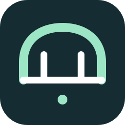

# Gemini Bridge

[English](README.md) · [Türkçe](README.tr.md) · [Releases](https://github.com/ipekbayrak/gemini-bridge/releases)

[](https://github.com/ipekbayrak/gemini-bridge/actions/workflows/ci.yml)



Codex plans, designs and decides. Your local **Antigravity CLI** runs routine implementation, research, summaries, tests and Chrome DevTools tasks using your own account.

## What this does — and where it works

Delegate routine work from a **local ChatGPT/Codex desktop coding chat** to the official Antigravity CLI. Keep architecture, product decisions, UI/UX, icons and important images with the host assistant; let Gemini implement the agreed design, collect research, run compatible tests and drive Chrome.

This requires a desktop host with local plugin execution. It is **not a ChatGPT web/mobile connector**, shared-account relay, or quota bypass. Each user signs into their own Antigravity account. OpenAI orchestration and review still consume OpenAI quota; delegated work consumes Antigravity quota. Savings vary with workload and are not guaranteed.

**Known native-build limitation:** some Gradle daemon connections, Xcode services and other native build operations cannot run in the provider sandbox. A successful Python/browser test does not certify those workflows. Tool errors and policy denials produce `needs_review`, not `succeeded`; the worker must not bypass the sandbox or reroute a denied action to another executor. No claim of fully unattended Android/iOS builds is made.

## Quick start

Requires **macOS or Linux**, **Python 3.11+**, **Codex CLI/desktop**, and the official **Antigravity CLI (`agy`, 1.5.1 or newer)**. Sign in to Antigravity interactively before using the bridge. Windows is not supported in this version. Chrome automation additionally requires Node.js/npm (Node 20.19+, 22.12+, or 23+) and Google Chrome.

Install the official Codex desktop/CLI and [Antigravity CLI](https://antigravity.google/docs/getting-started?tab=cli), then run `agy` once to sign into **your own** account. Model availability and sandbox support depend on that account. The bridge does not create or share accounts.

Clone this repository (or extract a ZIP from [Releases](https://github.com/ipekbayrak/gemini-bridge/releases)):

```sh
git clone https://github.com/ipekbayrak/gemini-bridge.git
cd gemini-bridge
```

Check the environment and install:

```sh
python3 scripts/setup.py check --json
python3 scripts/setup.py install
```

If your `python3` is older than 3.11, invoke the installer with a supported Python executable. The packaged MCP launcher discovers supported Python installations at runtime.

For browser work and automatic routing across new chats, explicitly enable these options:

```sh
python3 scripts/setup.py install --with-chrome --auto-route --allow-development --disable-credit-overage
```

Default installation does **not** change global instructions, Antigravity permissions, credentials, browser configuration or credit settings. Each flag above opts into the corresponding change. Existing Chrome MCP configuration is preserved; use `--replace-chrome` with `--with-chrome` only when you intend to replace it.

The installer copies the plugin into a durable directory under your Codex home and registers the `gemini-bridge-local` marketplace. The extracted ZIP is not needed after a successful installation. No account credentials or tokens are bundled or copied.

## Use

In the desktop composer, type **`/gemini-bridge`** and select the matching skill from the slash menu. You can also explicitly invoke **`$gemini-bridge`**. CLI versions that do not offer skill slash shortcuts support `$gemini-bridge` or `/skills` instead. Reload the app or open a new chat if the skill list has not refreshed.

```text
/gemini-bridge Bu projeyi tamamla. Mimari, UI ve kararları sen yönet.
```

When automatic routing is configured, just describe your task; naming the plugin is unnecessary.

**Codex retains:** general planning, architecture, deep reasoning, UI shell and interaction design, icons/logos, important image generation, significant decisions and final review.

**Gemini executes:** implementation of the approved design, familiar code patterns, file exploration, mechanical edits, research collection, summaries, build/test/lint, bug reproduction and browser checks. Research interpretation and final acceptance remain with Codex.

## Models and account usage

| Profile | Exact model | Use |
|---|---|---|
| `heavy` (default) | `gemini-4-argon-high` | Most implementation work; the CLI calls this High |
| `medium` | `gemini-4-argon-medium` | Short, fully specified mechanical tasks |

The bridge calls the official local `agy` executable with its cached login. It does not extract OAuth tokens or call private backend endpoints. There is no automatic model downgrade, paid API fallback or quota retry. `--disable-credit-overage` disables Antigravity's additional AI-credit setting; users can later change that setting themselves. Quota availability still depends on the user's account and provider.

## Browser and permissions

Chrome DevTools uses a separate isolated headless Chrome profile. It cannot automatically access the user's normal Chrome tabs or logged-in cookies. The pinned server is `chrome-devtools-mcp@1.12.0`; `npx` obtains that package from npm on first use. No Node packages are bundled in this ZIP.

The bridge uses `accept-edits` with session-only `enableTerminalSandbox=true` and `toolPermission=proceed-in-sandbox`, never `--dangerously-skip-permissions`. Workspace/task boundaries in the prompt are **not an OS sandbox**. Antigravity's existing permission rules apply. Chrome setup also grants the named MCP server and localhost permissions, and enables extension test tools. The optional development rules permit selected inspection/build/test commands and the named Chrome MCP server, not every terminal command. Repository scripts can execute code: use trusted workspaces and review delegated results. This plugin does not authorize publishing, deployment, purchases, messages to others or credential access.

## Tools and diagnostics

MCP tools: `agy_start`, `agy_status`, `agy_result`, `agy_cancel`, `agy_doctor`.

```sh
python3 scripts/bridge.py doctor
python3 scripts/bridge.py start --workspace /absolute/project/path --task-file /absolute/task.txt --profile heavy
python3 scripts/bridge.py status JOB_ID
python3 scripts/bridge.py result JOB_ID
python3 scripts/bridge.py cancel JOB_ID
```

Jobs persist across MCP restarts. One job per workspace runs at a time. The result includes a short response and evidence paths; detailed transcripts remain on disk. Exit code zero or an agent's SUCCESS is not proof of task acceptance. Permission denials, partial output, timeouts and cancellation are handled separately.

If the CLI cannot find the pinned model or the account quota is exhausted, resolve that condition before retrying. If a command needs permission, grant only the required command rather than bypassing all checks.

## Data and privacy

The bridge itself has no hosted backend or analytics. Task prompts and the files read by Antigravity are processed under the user's Antigravity account; this is not fully offline inference. Review the provider's terms and data controls. Jobs, prompts and raw tool output are stored locally under `~/.local/state/codex-antigravity-bridge` (override: `AGY_BRIDGE_STATE`). Logs may contain project code and task data; do not include them in redistributed packages. No existing user configuration, credentials, personal logs or demo-job identifiers belong in a release ZIP.

## Testing and distribution

```sh
python3 -m unittest discover -s tests -v
```

Tests use fake CLIs and temporary directories. They do not require a real subscription or consume model quota. CI runs the offline suite on macOS and Linux; live provider/browser checks are reported separately, never inferred from fake-CLI tests. Installation tests simulate a fresh user home; this is not a claim of a physical test on every supported OS. Live Antigravity and Chrome acceptance was performed on macOS. Linux CI covers offline code/packaging tests, not a signed-in Antigravity/Chrome end-to-end run.

This is a manually installable plugin package, **not an approved store listing**. Public distribution through the OpenAI directory has a separate review process. Local MCP submissions currently require prior organization approval: https://developers.openai.com/plugins/deploy/desktop-only

Remove the installed plugin with:

```sh
codex plugin remove antigravity-bridge@gemini-bridge-local
```

Removal does not delete task logs or undo opt-in settings. To stop automatic routing, remove only the Gemini Bridge marked block added to your global `AGENTS.md`; preserve other instructions. Disable/remove the Chrome MCP server separately if you no longer use it.

Gemini Bridge is an independent integration, not an official Google or OpenAI product. Antigravity, Gemini, Chrome and Codex belong to their respective providers.

## License

MIT — see [LICENSE](LICENSE). The license covers this bridge code, not Google/OpenAI services, accounts, brands or third-party dependencies. Each provider’s terms remain separate.

## Task-scoped read access (0.3.0)

For a read-only audit, the host supplies destinations and files already authorized by the human task **before** dispatch:

```json
{"access":{"read_urls":["https://example.invalid/page"],"read_files":["/absolute/approved-file.json"]}}
```

`agy_start` accepts this optional `access` object. CLI uses `--access-file access.json` with the inner object (`read_urls`/`read_files`). Only session-local `read_url(host)` and `read_file(canonical-path)` rules are added. No global configuration changes, `execute_url`, file writes or blanket permissions are added. Existing CLI deny/ask conflicts stop preflight. Provider/project/organization rules still apply. Domain grants can cover subdomains; exact URL limits remain a task contract, not a network firewall.

Declare only human-authorized targets. “Public site” or “general-use key” descriptions do not authorize reading unrelated files or exposing their contents. A denied request is returned as a blocker; the bridge never retries or widens permissions automatically. `blocked_access`, `tool_failures`, `permission_denials` and `next_action` help the host report specific failures instead of forwarding generic approval questions.
